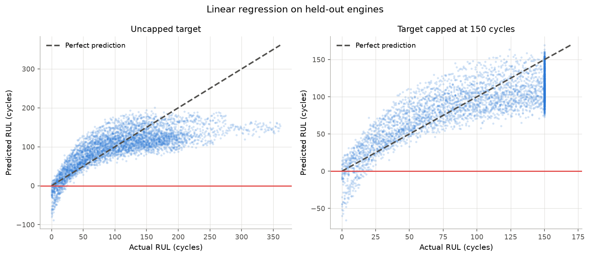
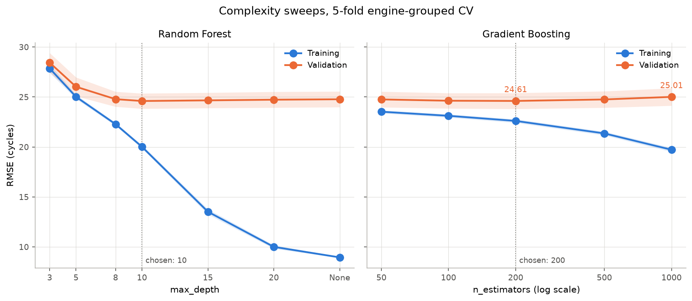
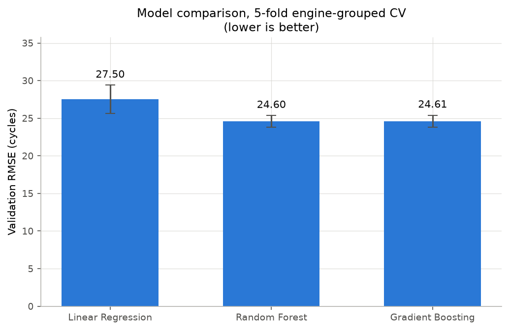

# Predicting a Turbofan Engine's Remaining Useful Life

Aircraft engines are serviced on fixed schedules and rules of thumb, which
means some engines are pulled with hundreds of cycles of life left and others
are left running too long. This project predicts **remaining useful life
(RUL)** — how many operational cycles an engine has before it fails — from its
sensor readings, using NASA's C-MAPSS FD001 dataset. Three regressors on a
deliberate complexity ladder (linear regression, random forest, gradient
boosting) are compared under cross-validation that holds out whole engines,
and scored on RMSE, MAE, R² and the asymmetric PHM08 challenge score that
charges more for a late prediction than an early one.

## Dataset

The data is **simulated**, and that is the point rather than a shortcut. Real
aircraft engines are never run to failure — they are pulled for maintenance
long before, because the cost of a real failure is measured in aircraft. So
run-to-failure data of the kind you would get from a lab test rig does not
exist at scale for turbofans. NASA built C-MAPSS, a thermodynamic simulation
of a 90,000 lb-thrust engine, to generate the fleet-wide degradation histories
that the real world cannot supply: engines started at varied initial wear,
degraded until failure, and recorded with realistic sensor noise.

FD001 is the simplest of the four subsets — one operating condition, one fault
mode (HPC degradation):

| | Engines | Rows |
|---|---|---|
| `train_FD001.txt` | 100, each run to failure | 20,631 |
| `test_FD001.txt` | 100 different engines, truncated mid-life | 13,096 |
| `RUL_FD001.txt` | true RUL at each test engine's last cycle | 100 |

Training engines fail between 128 and 362 cycles, mean 206.31. Full column
layout, citation and sensor descriptions are in
[`data/README.md`](data/README.md). The files are committed, so the repo runs
on clone.

### Key decisions

**The target is clipped at 150 cycles.** RUL is computed per engine as
`max(Cycle) - Cycle`, then capped. An engine 300 cycles from failure looks
identical to one 200 cycles from failure — the degradation has not started, so
the sensors cannot separate them. Leaving the target uncapped asks the model
to learn a distinction that is not in the data. The cap is the `--clip`
argument.

**Eight columns are dropped.** Seven (`Op S3`, `S1`, `S5`, `S10`, `S16`,
`S18`, `S19`) hold a single value throughout and are detected programmatically
with `nunique() == 1`. `S6` is dropped by name: it has two values, but one of
them covers 98% of rows. `ID` and `Cycle` are also excluded from the features —
`ID` is an arbitrary label, and `Cycle` would leak the answer, since RUL is
derived from it. That leaves 16 features.

**Splits group on engine, never on rows.** Consecutive cycles from one engine
are near-duplicates. A split that cuts across rows trains on cycle 100 and
validates on cycle 101, reporting a score the model has not earned. All
validation here is 5-fold `GroupKFold` on engine ID.

## Running

```bash
conda env create -f environment.yml
conda activate turbofan-rul
python run.py --subset FD001
```

Writes `results/metrics_cv.csv`, `results/metrics_test.csv`,
`results/sweep_rf.csv`, `results/sweep_gb.csv` and three PNGs to `figures/`.
The sweeps are the slow part (~7 minutes); `--no-sweep` skips them.
[`notebooks/results.ipynb`](notebooks/results.ipynb) walks through the same
analysis with commentary.

## Results

Cross-validated on the 100 training engines, 5 folds grouped by engine, mean ±
std across folds:

| Model | Validation RMSE | MAE | R² |
|---|---|---|---|
| Linear Regression | 27.50 ± 1.89 | 22.42 ± 1.58 | 0.696 ± 0.041 |
| Random Forest | **24.60 ± 0.76** | 18.74 ± 0.84 | **0.757 ± 0.015** |
| Gradient Boosting | 24.61 ± 0.80 | **18.70 ± 0.93** | 0.757 ± 0.016 |

Fit on all 100 training engines and scored on the 100 unseen test engines, one
row each at its last observed cycle:

| Model | Test RMSE | MAE | R² | PHM08 |
|---|---|---|---|---|
| Linear Regression | 23.90 | 19.13 | 0.669 | 2,590 |
| Random Forest | **21.89** | 16.09 | **0.722** | 2,700 |
| Gradient Boosting | 22.22 | **15.90** | 0.714 | 2,857 |

RMSE and MAE are in cycles. PHM08 is a sum over the 100 engines, so it is only
comparable across rows of this table, not against the CV numbers.





## Findings

**Clipping the target fixed a problem that was not overfitting.** With an
uncapped target the linear model scored 41.0 train / 56.3 validation on a
single 80/20 engine split — a 15-cycle gap that reads like textbook
overfitting. Capping at 150 closed it to 26.95 / 28.61. Nothing about the
model's capacity changed, so the gap was never variance; it was error from the
high-RUL region where the sensors carry no signal, and the validation set
happened to hold more of it. Under 5-fold CV the gap vanishes almost entirely
(44.63 / 44.88 uncapped, 27.28 / 27.50 capped), which confirms the diagnosis
from the other direction: averaged over folds there is no gap to explain.

**Linear regression's real limitation is bias, not variance.** The left panel
of the first figure shows it: the point cloud curves away from the diagonal
instead of scattering around it, flattening above ~180 cycles. A plane cannot
follow a curved degradation path. The clearest symptom is that it predicts
*negative* remaining life on 621 of 20,631 held-out rows (3.0%, down to −66
cycles) — an engine with less than no life left. This is why no regularization
was applied: the train/validation gap is 0.2 cycles after clipping, so there is
no variance for a penalty to remove, and shrinking coefficients would only add
to the bias.

**The random forest overfits heavily but does not get worse for it.** At full
depth, training RMSE falls to 8.95 while validation sits at 24.77 — a 16-cycle
gap. Yet validation is flat from depth 8 onward (24.78, 24.60, 24.67, 24.73,
24.77). Bagging is why: each tree memorizes its bootstrap sample differently,
and averaging 100 of them cancels the individual errors out. Depth 10 was
chosen as the start of that plateau — it is the cheapest model that gives up
nothing.

**Gradient boosting shows a genuine U-shape.** Validation RMSE bottoms at 200
estimators (24.61) and climbs to 25.01 by 1000. Unlike bagging, boosting fits
each tree to the *previous ensemble's residuals*, so extra trees do not average
out — past the point where the signal is exhausted they fit noise. The rise is
only 0.41 cycles, smaller than the across-fold standard deviation of ~0.8, but
it is consistent: boosting at 1000 estimators is worse than at 200 in **all
five folds** individually, so the direction is real even where the magnitude is
within noise.

**Test scores are better than validation, and that is not better
generalization.** Every model gains 2–3 cycles moving from validation to test
(RF 24.60 → 21.89). The test set scores one mid-life snapshot per engine; the
validation folds score *every* cycle, including the near-failure ones where
prediction is hardest and the easy high-RUL ones the clip flattened. The
giveaway is R², which barely moves and in fact drops slightly (RF 0.757 →
0.722). If the models genuinely generalized better to the test engines, R²
would rise with RMSE falling. The two sets are not directly comparable.

**Both tree models beat linear by about 2 cycles; they do not beat each
other.** On test, 21.89 and 22.22 against 23.90. On cross-validation, 24.60 and
24.61 — a gap of 0.007 cycles against fold standard deviations of 0.76 and
0.80. Bagging and boosting reach the same accuracy by opposite routes: the
forest builds deep independent trees and averages away their variance, while
boosting builds shallow trees in sequence that each correct the last. On this
data the two routes arrive at the same place, and the honest conclusion is a
tie.

**The PHM08 ranking disagrees with RMSE, and should not be trusted here.** It
ranks linear regression *best* (2,590) despite its worse RMSE, because all
three models are biased late on the test snapshot (66–72% of predictions
overestimate remaining life) and linear's errors happen to be distributed
slightly more favourably. But the score is a sum of exponentials, so it is
dominated by a handful of engines: the single worst prediction contributes
~30% of each model's total, and the worst five contribute 59–74%. With 100
engines, that is a ranking decided by about five of them.

## Limitations

- **The data is simulated.** C-MAPSS models degradation as a smooth process
  with injected noise. Real engines accumulate damage through discrete events —
  bird strikes, hard landings, maintenance that resets some wear and not other
  wear. These results do not transfer to a real fleet without revalidation.
- **FD001 only: one operating condition, one fault mode.** The hard parts of
  the problem are absent by construction. FD002–FD004 add six operating
  conditions and a second fault mode, which is where feature engineering and
  condition normalization start to matter. Nothing here has been tested against
  that.
- **Validation and test numbers are not directly comparable.** They score
  different things — every cycle versus one snapshot per engine — so the
  test-set improvement is an artifact of which rows are scored, not evidence
  of better generalization.
- **100 engines is a small sample.** Fold-to-fold standard deviation is around
  0.8 cycles for the tree models and 1.9 for linear. Differences smaller than
  that, including the entire gap between the forest and boosting, are noise.
  Several conclusions here rest on paired per-fold comparisons precisely
  because the aggregate means cannot carry them.
- **No model here is calibrated or produces an uncertainty estimate.** A
  maintenance decision needs a probability of failure within the next N cycles,
  not a point estimate — and the asymmetric cost structure that PHM08 gestures
  at is never actually optimized for, only measured.

## References

**Dataset**
Saxena, A., & Goebel, K. (2008). *Turbofan Engine Degradation Simulation Data
Set*. NASA Prognostics Data Repository, NASA Ames Research Center, Moffett
Field, CA.
<https://data.nasa.gov/dataset/simulating-degradation-data-for-prognostic-algorithm-development>

**Research paper**
Saxena, A., Goebel, K., Simon, D., & Eklund, N. (2008). Damage Propagation
Modeling for Aircraft Engine Run-to-Failure Simulation. *Proceedings of the 1st
International Conference on Prognostics and Health Management (PHM08)*, Denver,
CO, 1–9.

**Textbook**
James, G., Witten, D., Hastie, T., Tibshirani, R., & Taylor, J. *An
Introduction to Statistical Learning with Applications in Python* (1st ed.).
<https://www.statlearning.com/>

**Library**
Pedregosa et al. (2011). Scikit-learn: Machine Learning in Python. *JMLR* 12,
2825–2830. <https://scikit-learn.org/>

## Layout

```
run.py                      pipeline entry point
turbofan_rul/
  data.py                   load files, build RUL target, drop dead sensors
  split.py                  GroupKFold by engine
  models.py                 the three model definitions
  evaluate.py               RMSE, MAE, R², PHM08 score
  plots.py                  predicted-vs-actual, complexity sweeps, comparison
notebooks/
  results.ipynb             the analysis with commentary
  course_original.ipynb     the original exploratory notebook, unmodified
data/FD001/                 the three source files
figures/                    generated PNGs
results/                    generated CSVs
```
